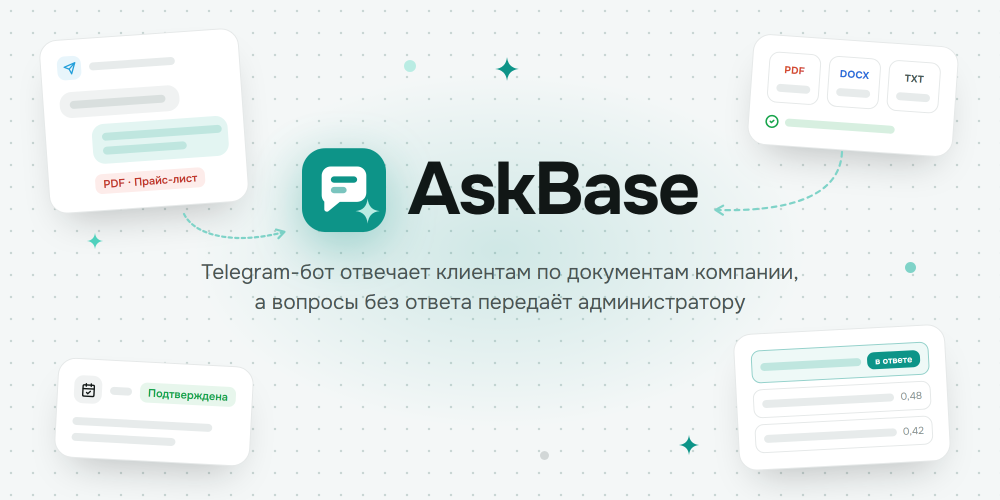
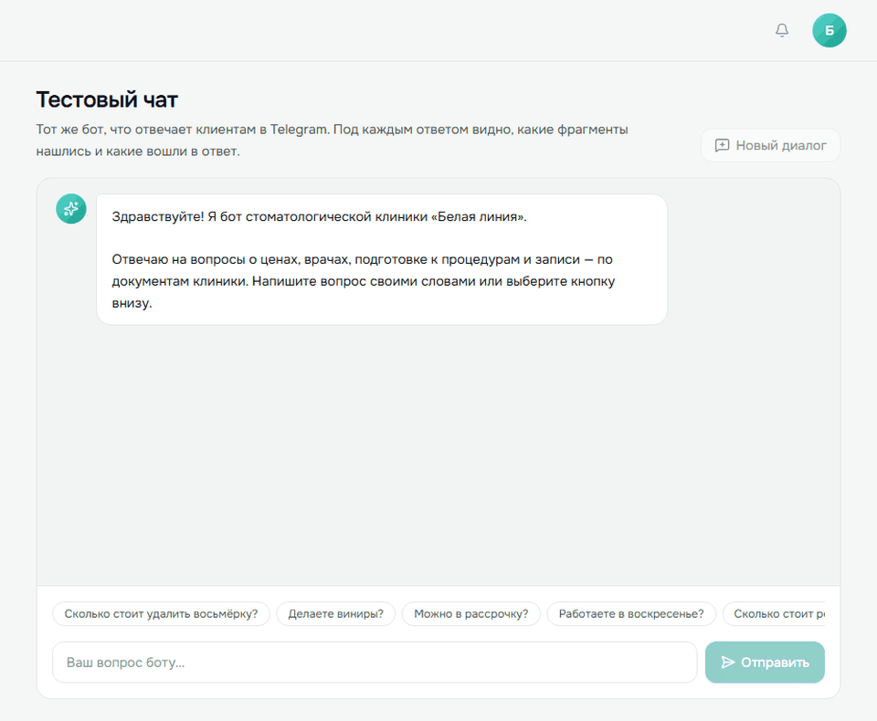
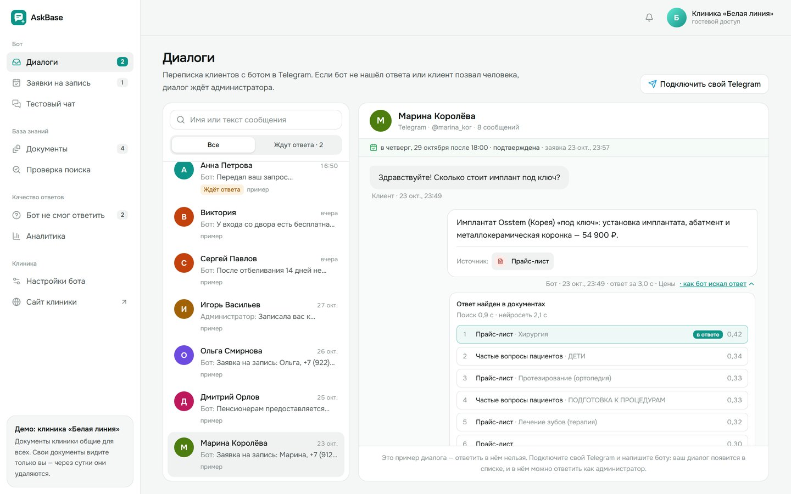
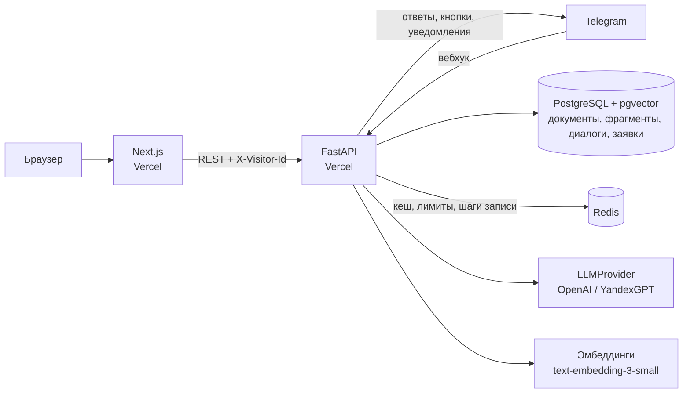

# AskBase — Telegram-бот, который отвечает по базе знаний

<p align="center">
  
</p>

Бот отвечает клиентам компании строго по её документам: прайсу, списку врачей, ответам на частые вопросы и правилам записи. Под каждым ответом — документ-источник. Если ответа в документах нет, бот не выдумывает, а честно говорит «Уточню у администратора» и передаёт вопрос человеку. Ещё он записывает на приём по шагам. Владелец загружает документы, видит все диалоги и заявки и отвечает клиентам в веб-админке.

**Для кого:** клиники, салоны, автосервисы и другие компании, где администратор весь день отвечает на одни и те же вопросы о ценах, графике и подготовке, а ночью и в выходные клиенты остаются без ответа.

**Демо-легенда:** стоматологическая клиника «Белая линия», Москва. Клиника, врачи, цены и адрес вымышлены.

## 🚀 Демо

- Сайт: **https://askbase-topaz.vercel.app**
- Админка: https://askbase-topaz.vercel.app/login → «Войти как гость», без регистрации
- Telegram-бот: [@white_line_askbase_bot](https://t.me/white_line_askbase_bot)
- API: https://askbase-api.vercel.app/docs
- Гость видит 8 демо-диалогов, может спросить бота в тестовом чате, загрузить до 3 своих документов и подключить свой Telegram — его документы и настройки видит только он, через сутки они удаляются.

<p align="center">
  
</p>

## Что умеет

**Сценарий:** клиент пишет боту в Telegram → бот находит в документах нужные фрагменты → нейросеть отвечает только по ним и называет источник → если ответа нет, вопрос уходит администратору, диалог в админке помечается «Ждёт ответа», администратору приходит уведомление → он отвечает из админки, ответ уходит клиенту в Telegram.

### Telegram-бот

- **Ответы по документам** со ссылкой на источник: «Удаление зуба мудрости — 6 500 ₽… Источник: Прайс-лист». Понимает уточнения в диалоге: «А сколько стоит?» после вопроса о винирах ищется как «Сколько стоит винир».
- **Честный отказ:** вопрос не по базе («Сколько стоит ремонт машины?», «Вы делаете ринопластику?») — «Уточню у администратора и вернусь с ответом», без догадок.
- **Запись на приём по шагам:** имя → телефон кнопкой «Поделиться номером» → повод → удобное время. Кнопки времени сразу с днём («Завтра днём»), а «завтра» и «в субботу» сохраняются датой: заявка не «висит на завтра» через неделю. Повторную такую же заявку бот не создаёт. «Я записан?», перенос и отмена — тоже словами.
- **Цены по разделам** кнопками и прайс-лист PDF файлом; «Связаться с администратором» в меню.
- Пока клиенту отвечает администратор, бот в этом чате молчит 30 минут или до кнопки «Включить бота».

### Админка

| Раздел | Что там |
| --- | --- |
| Диалоги | Переписка клиентов с ботом; ждущие человека — сверху. Ответ администратора уходит клиенту в Telegram. Заявки клиента — над перепиской |
| Заявки на запись | Карточки с телефоном, поводом и временем; «Подтвердить» и «Отменить». Фильтр по статусу |
| Тестовый чат | Тот же бот, но под каждым ответом видно, как он искал: уточнённый вопрос, найденные фрагменты с близостью, какие вошли в ответ |
| Бот не смог ответить | Вопросы, которых нет в базе. Ответ отсюда добавляется в документ «Ответы администратора» — и бот начинает отвечать на такой вопрос сам |
| Аналитика | Диалоги по дням за неделю, доля вопросов с ответом, время ответа, топ тем |
| Документы | PDF, DOCX, TXT или ссылка на страницу сайта; индексация за несколько секунд, фрагменты каждого документа можно посмотреть |
| Проверка поиска | Какие фрагменты найдутся по вопросу — до обращения к нейросети |
| Настройки бота | Приветствие, тон ответов, телефон и часы работы |

О том, что нужен человек — клиент позвал администратора, бот не нашёл ответа, клиент оставил, изменил или отменил заявку, — админка сообщает звуком, всплывающим уведомлением и числом во вкладке браузера. Длинные списки и переписка подгружаются при прокрутке.

<p align="center">
  
</p>

## Как бот находит ответ

```
Вопрос ─► уточнение по истории диалога («А сколько стоит?» → «Сколько стоит винир E.max?»)
            │
            ▼
   гибридный поиск: по смыслу (pgvector) + по словам (полнотекстовый, русский) ─► RRF ─► 6 фрагментов
            │
            ├── ничего похожего ─► «Уточню у администратора», нейросеть не вызывается
            ▼
   нейросеть отвечает только по фрагментам, JSON по схеме: ответ, id источников, намерение
            │
   код проверяет, что источники — из найденных фрагментов; нет источника ─► вопрос администратору
            ▼
   ответ клиенту + «Источник: Прайс-лист»
```

- **Гибридный поиск.** Векторы находят перефразировки («чистка» ↔ «профессиональная гигиена»), полнотекстовый поиск — точные слова: фамилии врачей, названия процедур, цифры. Списки сливаются методом RRF.
- **Документы режутся по смыслу:** фрагмент — целые абзацы до 800 символов, новый раздел начинает новый фрагмент, на стыке — небольшой перехлёст. У фрагмента запомнен раздел («Прайс-лист · Протезирование») — он виден в разборе поиска. Таблицы из DOCX и перенесённые строки PDF собираются обратно в строки «услуга — цена».
- **Одна модель решает и что хочет клиент:** вопрос, запись, «я записан?», отмена, позвать человека или просто «спасибо». Запись и отмена ведутся кодом по шагам, а не нейросетью.
- **Слой `LLMProvider`** (`backend/app/llm/`): OpenAI-совместимые API или YandexGPT — если данные не должны уходить за рубеж; без ключа работает шаблонный режим.
- Медленный ответ модели страхуется повторным запросом через 3,5 с — берётся тот, что пришёл первым.

## Точность

`backend/app/seed/eval-questions.json` — 20 вопросов по документам с эталонными фактами и документом-источником и 5 вопросов вне базы. Набор зафиксирован до настройки промптов. Скрипт задаёт их боту тем же конвейером, что в Telegram, и сверяет ответы:

```bash
cd backend
uv run python scripts/evaluate.py --report eval-report.html
```

Последний прогон на gpt-5.6-luna: **по документам верно 19 из 20**, источник указан верно во всех 20, **вопросы вне базы переданы администратору в 5 из 5**. Медиана времени ответа — 2,3 с, 95% ответов — быстрее 3,6 с. Единственный «промах» — ответ «отбеливание во время беременности не проводят»: по сути верный, но строгая проверка ищет одну из заданных формулировок и засчитывает его как ошибку.

## Защита бюджета публичного демо

| Мера | Значение по умолчанию |
| --- | --- |
| Вопросы | до 500 символов, 30 в час с одного IP и из одного Telegram-чата |
| Кеш | одинаковые вопросы к той же базе берутся из Redis 7 дней |
| Без нейросети | если в базе нет ничего похожего, модель не вызывается |
| Свои документы гостя | до 3, до 2 МБ и 50 000 символов, PDF до 20 страниц; 10 загрузок в час; удаляются через сутки |
| Очистка | ночная задача удаляет документы гостей старше суток |

## Архитектура



- Регистрации нет: фронтенд создаёт анонимный `visitor_id` в `localStorage`. Гость видит демо и своё; владелец клиники входит по паролю и меняет документы и настройки для всех клиентов.
- Бот написан на Bot API поверх `httpx`, без aiogram: один и тот же код работает в вебхуке на Vercel и в опросе локально. Вебхук защищён секретным заголовком и ставится сам.
- Шаги записи хранятся в Redis час: если клиент отвлёкся, запись начнётся заново.

## Стек

| Часть | Технологии |
| --- | --- |
| Фронтенд | Next.js 16 (App Router), React 19, TypeScript, Tailwind CSS 4, SWR, lucide-react |
| Бэкенд | Python 3.12, FastAPI, SQLAlchemy 2 (async), Pydantic 2, httpx |
| Поиск | PostgreSQL 16 + pgvector, полнотекстовый поиск PostgreSQL (русский), RRF |
| Данные | PostgreSQL (в демо — Neon), Redis (в демо — Upstash) |
| Нейросеть | OpenAI API (gpt-5.6-luna, text-embedding-3-small), YandexGPT |
| Документы | pypdf, python-docx, BeautifulSoup |
| Telegram | Bot API: вебхук на Vercel, опрос в Docker |

## Демо-база знаний

`backend/app/seed/` — документы клиники и тестовый набор вопросов:

| Документ | Формат | Файл |
| --- | --- | --- |
| Прайс-лист | PDF | `docs/prajs-list.pdf` |
| Врачи и график работы | DOCX | `docs/vrachi-i-grafik.docx` |
| Частые вопросы: подготовка, гарантии, оплата | TXT | `docs/faq.txt` |
| Правила записи | страница сайта | `docs/pravila-zapisi.html` — она же открывается по ссылке «Сайт клиники» |

Исходные тексты PDF, DOCX и страницы лежат в `source/` (Markdown), файлы собирает `backend/scripts/build_demo_docs.py`. В «Диалогах» — 8 вымышленных демо-диалогов: их ответы получены настоящей моделью скриптом `backend/scripts/build_demo_dialogs.py` и лежат в `demo-dialogs.json`.

## Запуск локально

Нужен Docker.

```bash
cp .env.example .env   # впишите OPENAI_API_KEY; без ключа поиск работает упрощённо, по словам
docker compose up -d --build
```

- http://localhost:3000 — лендинг
- http://localhost:3000/login — вход в админку: гостем (без пароля) или владельцем клиники (пароль из `OWNER_PASSWORD` в `.env`)
- http://localhost:8000/docs — API

При первом запуске документы клиники индексируются сами.

### Telegram-бот

1. Создайте бота у [@BotFather](https://t.me/BotFather) и впишите токен в `.env`: `TELEGRAM_BOT_TOKEN=…`.
2. `docker compose up -d --build bot` — бот сам опрашивает Telegram, вебхук и публичный адрес не нужны.
3. Напишите боту `/start`. Чтобы переписка появилась в «Диалогах», нажмите там «Подключить свой Telegram» и откройте бота по ссылке.
4. Уведомления менеджеру о заявках и вопросах без ответа: отправьте боту `/myid` и впишите число в `.env` — `MANAGER_CHAT_ID=…`, затем `docker compose up -d --force-recreate api bot`.

Telegram отдаёт сообщения либо вебхуку, либо опросу. Если у бота стоит вебхук прода, локальный сервис `bot` их не получает и пишет об этом в лог — для локальной проверки заведите отдельного бота.

---

Демо-проект: клиника «Белая линия», врачи, цены и адрес вымышлены.
